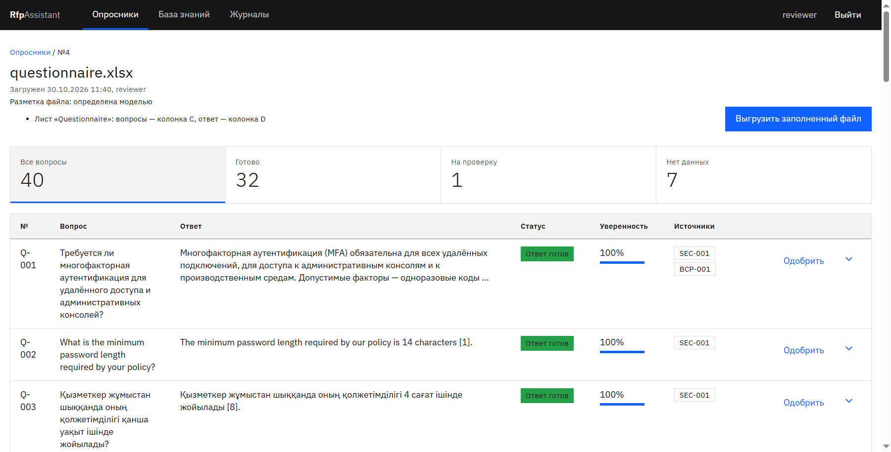
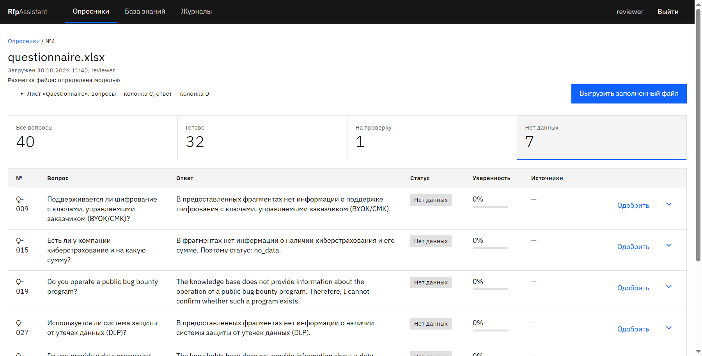
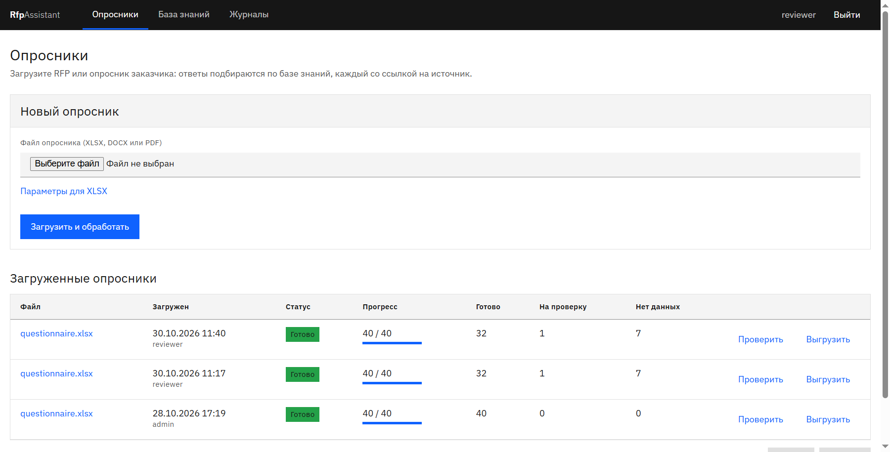
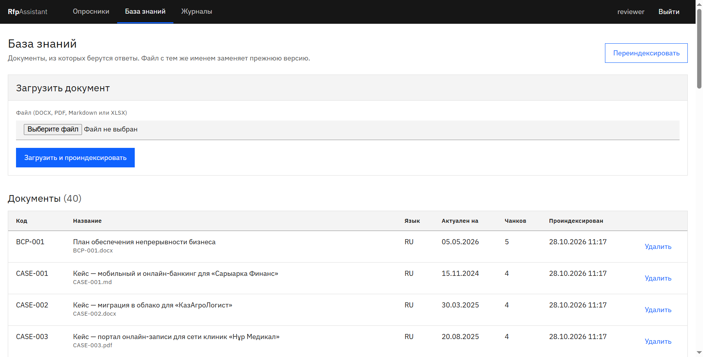
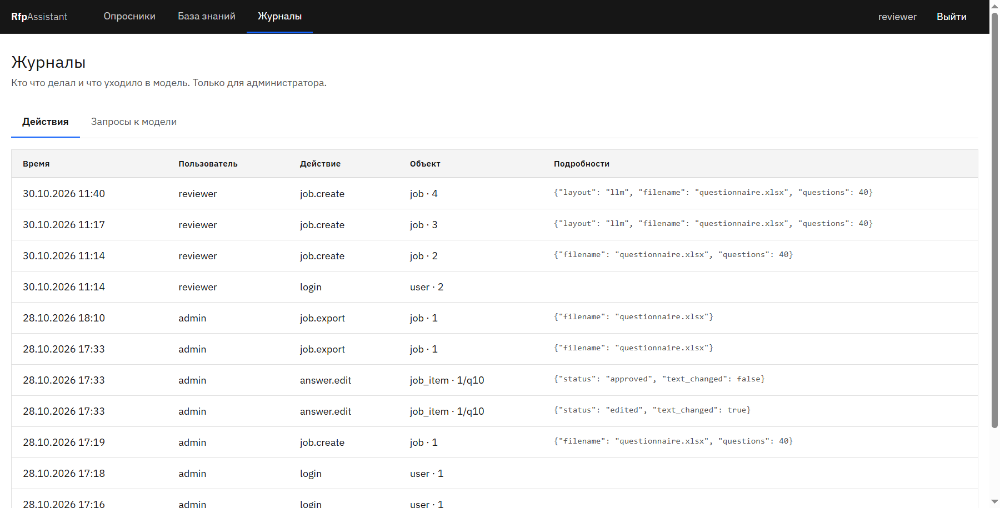
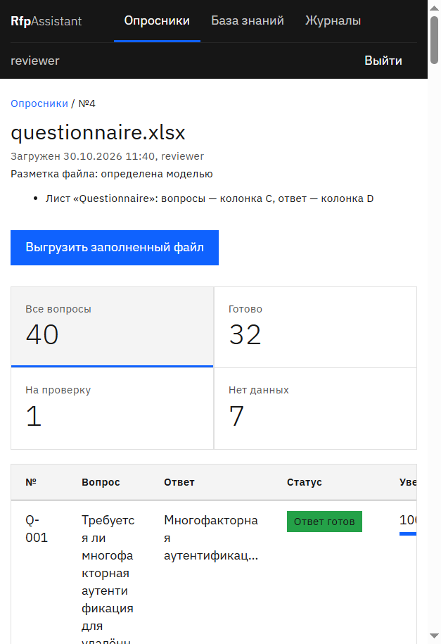

# RfpAssistant

*English version: [README.en.md](README.en.md)*

Демонстрационный RAG-сервис: заполняет RFP и опросники заказчиков ответами из базы знаний, к каждому ответу даёт
ссылку на источник и цитату, а если данных нет, честно отвечает «нет данных в базе знаний».

**Это демо-проект, а не выполненный заказ.** Он сделан как пример результата для отклика на задачу
Andersen Kazakhstan на Astana Hub в уменьшенном масштабе: база из 40 документов вместо 200, критерии
приёмки те же, что в ТЗ.
База знаний, заказчики, сертификаты и цифры в `data/` вымышлены: это компания Steppelight Technologies
(«Степлайт Технолоджиз»), см. `data/README.md`.

## Как это работает

```
загрузка файла (DOCX / XLSX)
  -> разметка: модель находит колонки/блоки вопросов и ответов, код проверяет разметку правилами
     (при сбое - откат на правила по заголовкам)
  -> для каждого вопроса: перевод запроса (ru / kk / en) моделью
  -> гибридный поиск: полнотекстовый (FTS) + векторный (pgvector), объединение через RRF
  -> ответ модели с цитатой из найденного фрагмента; код проверяет, что цитата есть в тексте фрагмента
     (иначе ссылка отбрасывается)
  -> нет данных или низкая уверенность -> «нет данных в базе знаний», без выдуманного ответа
  -> выгрузка в исходный файл с самопроверкой: ответы лежат там, где им положено быть
```

Каждый ответ хранит источник (документ, раздел), цитату и статус (`answered`, `needs_review`, `no_data`).
Действия пользователей пишутся в журнал аудита.

## Запуск за 3 команды

```
cp .env.example .env
docker compose up -d
# открыть http://localhost:8000
```

Перед запуском в `.env` задайте `SECRET_KEY`, `ADMIN_USERNAME`, `ADMIN_PASSWORD` (первый администратор
создаётся при старте) и `LLM_API_KEY` для OpenAI-совместимого сервиса. Значения в репозитории не хранятся.
Без ключа сервис поднимается, но вызовы модели недоступны.

Для работы без репозитория на хосте: Python 3.12 и `uv`; запуск вне Docker - `uv sync`, затем
`uv run uvicorn rfp.app:app` (нужен PostgreSQL с pgvector, `DATABASE_URL` в `.env`).

## Локальный режим (без внешнего API)

Профиль `local` поднимает сервер моделей Ollama рядом с приложением:

```
docker compose --profile local up -d
docker compose exec ollama ollama pull qwen2.5:7b
docker compose exec ollama ollama pull bge-m3
```

Затем в `.env` замените блок OpenAI на блок «Local mode» из `.env.example`: `LLM_BASE_URL=http://ollama:11434/v1`,
`LLM_MODEL=qwen2.5:7b` (ответы, перевод запроса, разметка), `EMBEDDING_MODEL=bge-m3`, `EMBEDDING_DIM=1024`.
Размерность векторов меняется с 1536 на 1024, поэтому нужна отдельная пустая база (новый volume или
`DATABASE_URL`) и повторная индексация базы знаний.

Оценка требований к железу: для модели 7B - видеокарта с 8 ГБ VRAM (GPU-блок в `docker-compose.yml`
закомментирован, его нужно включить и установить NVIDIA Container Toolkit) и 16 ГБ ОЗУ; на CPU работает
заметно медленнее.

**Замер качества и скорости на локальной модели - в пилоте, в этом репозитории не выполнялся.**
Цифры ниже относятся только к моделям OpenAI.

## Качество

Все цифры - из воспроизводимых прогонов, файлы с деталями лежат в `reports/`.

**Ответы, отложенный test-набор, 2026-10-30** (`reports/quality-2026-10-30-test.md`; набор `test` версии
`58926e1cc8cd`: 53 вопроса на русском, казахском и английском, 11 из них без ответа в базе; ответы `gpt-4o-mini`,
судья `gpt-4o`, эмбеддинги `text-embedding-3-small`). Набор собран отдельно и при настройке поиска и промптов
не использовался.

| Метрика | Результат | Порог ТЗ |
|---|---|---|
| Верные ответы | 78,6% | не менее 75% |
| Частично верные | 11,9% | - |
| Неверные | 9,5% | не более 10% |
| Ответы с источником | 95,2% | не менее 95% |
| Цитируемые ответы с эталонным документом | 92,5% | не менее 90% |
| «Нет данных» на вопросах без ответа в базе | 100% (11/11) | 18 из 20 |
| Вопросов найдено при разборе файлов | 100% (53/53) | не менее 95% |
| Время на вопрос | 4,6 с | 100 вопросов за 15 мин |
| Стоимость | $0,0003 на вопрос, $0,034 на 100 вопросов (без судьи) | - |

Точность оценивает модель-судья по эталонным ответам; в отчёте есть выборка из 10 пар для ручной проверки.
Пороги ТЗ заданы для набора из 100 вопросов, здесь 53, поэтому цифры ориентировочные. Запас по неверным
ответам небольшой: 4 из 42 вопросов.

Первый прогон на этом наборе показал, что на часть английских вопросов модель отвечала по-русски.
После исправления (язык вопроса определяется в коде и передаётся модели) набор прогнан ещё раз; цифры выше
относятся ко второму прогону. Первый прогон сохранён в `reports/quality-2026-10-30-test-before-language-fix.md`
(верных 81,0%, неверных 7,1%).

Dev-набор (55 вопросов) использовался для настройки; последний прогон на нём -
`reports/quality-2026-10-30-dev.md` (верных 75,0%, неверных 2,3%).

**Разметка файлов на публичных опросниках, 2026-10-29** (`reports/layout-2026-10-29-final.md`; модель `gpt-4o-mini`):
режим `llm` нашёл 966 из 1096 эталонных вопросов (88,1%); 5 из 7 файлов - на уровне 95% и выше. Ниже порога остались
`hecvat-4-16-github-mirror` (222/334, 66,5%) и `ut-system-3rd-party-intake` (13/16, 81,2%).
Режим `rules` (только правила по заголовкам): 386 из 724 (53,3%), 3 из 5 файлов на уровне 95% и выше.
Стоимость 9 вызовов модели: 0,0163 USD.

## API

Интерактивная документация OpenAPI - `http://localhost:8000/docs` (маршруты в `src/rfp/api/`: авторизация,
база знаний, задания на заполнение, журналы). Веб-интерфейс работает на тех же маршрутах.

## Скриншоты

Сняты 30.10.2026 на реальном прогоне dev-опросника (40 вопросов на трёх языках, модель `gpt-4o-mini`).

Проверка ответов: статус, уверенность, источники. Ответ на языке вопроса.



Вопросы, на которые в базе нет ответа: сервис так и пишет, без выдуманного ответа.



Список заданий, база знаний и журнал действий:







Телефон, 390 px:



## Структура репозитория

```
src/rfp/           сервис: app.py, config.py, llm.py, query.py, retrieval.py, answering.py, ingest.py
  api/ web/        маршруты API и веб-интерфейс (шаблоны, статические файлы, шрифты IBM Plex)
  questions/       поиск вопросов и разметка DOCX/XLSX
  export/          выгрузка ответов в исходный файл и самопроверка
  services/        база знаний, задания, эталонные ответы
  eval/            оценка качества (python -m rfp.eval)
  db/ documents/   схема pgvector, чтение документов
prompts/           промпты ответа, судьи, разметки
data/              вымышленная база знаний (kb_src, kb) и dev-набор (sets/dev)
scripts/           сборка базы знаний, оценка разметки
reports/           отчёты о прогонах
docs/              лицензии, журнал настройки, источники публичных опросников, скриншоты
tests/             тесты
```

## Тесты и CI

```
uv run ruff check .
uv run ruff format --check .
uv run pytest -q
```

CI (GitHub Actions, `.github/workflows/ci.yml`): те же три проверки, затем `docker compose up -d --wait` и
запрос `/health`. Оценка качества: `uv run python -m rfp.eval --set dev`.

## Ограничения демо

- Нет защиты от перебора паролей и CSRF-токена: только cookie `SameSite=Lax`.
- Разметка файла моделью вызывается синхронно при загрузке, поэтому загрузка большого файла ждёт ответа модели.
- Публичные опросники, на которых измерена разметка, в репозиторий не входят из-за лицензий
  (`data/public/` в `.gitignore`, список источников - `docs/public-questionnaires.md`).
- Качество и скорость на локальной модели не измерены.
- Фоновые задания не возобновляются после перезапуска контейнера: незаконченное задание нужно загрузить заново.

## Лицензии

Зависимости, образы, шрифт, htmx и модели с лицензиями - в [docs/licenses.md](docs/licenses.md).
